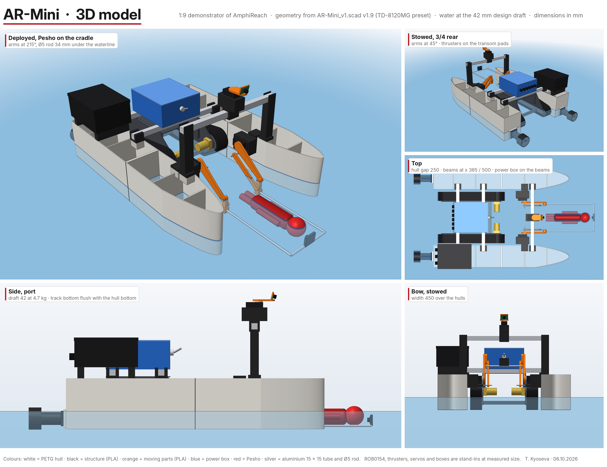

# AR-Mini · AmphiReach

AR-Mini is a ~1:9 physical demonstrator of **AmphiReach**, an autonomous amphibious rescue robot (simulation and paper 2025–2026, Horizon Academic). The robot finds a person in the water by body heat, lifts them onto a cradle between two catamaran hulls and drives out of the water on tracks.

**Status, 1 November 2026:** AR-Mini went into open water. At Pancharevo near Sofia, in rain, fog and 8 °C, it floated level, drove and turned from my phone and came back to the bank, with a dry electronics box (card C059, **Partial**: the dummy was not on board, so no rescue lift in the water, and the battery voltage at the end was not recorded). Latest release: **[R-1101](docs/releases/R-1101.md)** (tag `r2026-11-01`, 10 cards); earlier [R-1024](docs/releases/R-1024.md) and [R-1018](docs/releases/R-1018.md). Open: the right thruster is faulty (FAILS 173), the cradle lift drives on one PCA9685 channel only (FAILS 180), the tracks have not driven on the floor yet. Current state on one page: [docs/STATE.md](docs/STATE.md).

**As built for the water (31.10.2026)** — architecture [v4](docs/diagrams/AR-Mini_architecture_v4.png):

| Subsystem | What it is |
|---|---|
| Hulls | 2 × catamaran hull 610 × 100 × 120 mm, printed in 2 sections each (PETG aft, PLA fore), on two 15 × 15 aluminium beams; draft 20 mm as floated |
| Water drive | one Cuifati underwater thruster (12 V, ESC inside) on a printed `beam_leg` on the centreline + a NACA 0015 rudder on an MG90S servo; the second thruster is faulty (FAILS 173) |
| Land drive | DFRobot ROB0154 tracked chassis with 2 × BTS7960 (left track tested on the bench); taken off for the water runs |
| Rescue lift | parallelogram arms on 2 × TD-8120MG servos, Ø5 aluminium cradle; lifts the 1:9 dummy "Pesho" at ~0.24 A on the bench (C023) |
| Sensing | MLX90642-D45 and MLX90640 110° thermal cameras, OV3660 camera on a XIAO ESP32-S3 Sense (own Wi-Fi, records onboard), VBAT divider, leak probe |
| Control | Olimex ESP32-S3-DevKit-Lipo on two breadboards in a box (firmware env `remote_pool`), 74HCT125 3.3 → 5 V, PCA9685 for the lift; phone remote over Wi-Fi with ARM, STOP and a 500 ms heartbeat |
| Power | LiPo 3S 2200 mAh · 30 A inline fuse · 50 A main switch · 6-slot fuse block · 5 V bucks · KILL rocker → SAFE |
| Next board | carrier PCB rev B, 100 × 80 mm, designed and checked, not ordered yet ([pcb/carrier-revB/SPEC.md](pcb/carrier-revB/SPEC.md)) |

## Where to look
- **3D model** — [cad/3d/](cad/3d/): open `AR-Mini_3D.html` in a browser (rotate, run the lift, point at a part to see its name).
- **CAD** — [cad/openscad/AR-Mini_v1.scad](cad/openscad/AR-Mini_v1.scad): the whole robot and every printed part, parametric; `beam_leg.scad`, `rudder_frame.scad`, `rudder.scad` for the water configuration. Hull script for Fusion 360 in [cad/fusion/](cad/fusion/).
- **Every printed part** — [cad/printed/](cad/printed/): 19 models, 36 parts, 15 print jobs, ≈55 h, 2.39 kg, as STEP and 3MF.
- **Electronics** — architecture: [docs/diagrams/AR-Mini_architecture_v4.png](docs/diagrams/AR-Mini_architecture_v4.png) (as wired 31.10; v1–v3 kept beside it); wiring for the water runs: [docs/diagrams/AR-Mini_FINAL2_breadboard_pool_1031.png](docs/diagrams/AR-Mini_FINAL2_breadboard_pool_1031.png); first board: [pcb/xiao-breakout-rev0/](pcb/xiao-breakout-rev0/) (with all three DRC rounds); next board: [pcb/carrier-revB/SPEC.md](pcb/carrier-revB/SPEC.md); pins: [hardware/wiring/PINOUT.md](hardware/wiring/PINOUT.md); breadboard sheets: [hardware/breadboard/](hardware/breadboard/).
- **Firmware** — [firmware/](firmware/): PlatformIO projects for the DevKit-Lipo (bench envs incl. `remote_pool` used on the lake), the XIAO camera node and the Arduino Mega thruster test; host tests run in CI.
- **Bill of materials** — [docs/bom/](docs/bom/): the spreadsheet (with photos) and the one-page visual BOM ([v3, 28.10](docs/bom/AR-Mini_BOM_visual_v3.pdf)).
- **What went wrong and how it was fixed** — [docs/FAILS_AND_FIXES.md](docs/FAILS_AND_FIXES.md): 180 numbered entries, each with the reading that proved it, the fix and a rule.
- **Design decisions** — [docs/decisions/](docs/decisions/) · **build log** — [docs/LOG.md](docs/LOG.md) · **timeline with real dates** — [docs/timeline/TIMELINE.md](docs/timeline/TIMELINE.md) · **current state on one page** — [docs/STATE.md](docs/STATE.md).
- **Every test card** — [data/board/board.json](data/board/board.json): hypothesis, result, Pass / Partial / Fail, link to the photos.

## How it is built: human in the loop
I (Teddy, Teodora Kyoseva) work alone. I measured every part, made the design decisions, printed, wired, assembled, tested and debugged everything. AI tools drafted code, CAD and diagrams from my specs; I checked each against a measurement before it touched hardware.

The tools: **Claude** (test plans, CAD and PCB scripts, diagrams, documentation), **Cursor** (code and commits; its background agents work on night tasks in [tasks/night/](tasks/night/) and open pull requests), **Gemini** and **ChatGPT** (second opinions, long datasheets, test videos). Two AI mistakes I caught before they reached hardware: an AI-drawn wiring sheet with the breadboard rails mirrored (FAILS 178), and a PCB footprint 1.6 mm short from an AI-written script, found with a 1:1 paper print (FAILS 152). Roles and rules: [AGENTS.md](AGENTS.md) · diagrams: [docs/process/](docs/process/).

- `dev` — AI agents commit here after [scripts/check.sh](scripts/check.sh) passes (OpenSCAD render, KiCad ERC/DRC, PlatformIO builds, host tests).
- `night/*` — background agents, each ends with a pull request to `dev`.
- `main` — releases only; I merge `dev` into `main` by pull request after the physical tests are logged (tags `r2026-10-18`, `r2026-10-24`, `r2026-11-01`).
- Every test is a card with an ID (C001, C002 …). The same ID names the photo folder, the data files and the commit message.

## About this repository
The repository was created on **6 October 2026**. Work from 28 September to 6 October was imported in the first commits with its files unchanged; the real dates of that work are in the timeline and in the build log, not in the commit dates. Photos and videos are kept outside git (iCloud), indexed in [media/LINKS.md](media/LINKS.md). The research manuscript is not part of this repository.

## License
Code: MIT. CAD, PCB, documentation and images: CC BY 4.0. See [LICENSE](LICENSE) and [decision 0001](docs/decisions/0001-license.md).

See [CONTRIBUTORS.md](CONTRIBUTORS.md).
