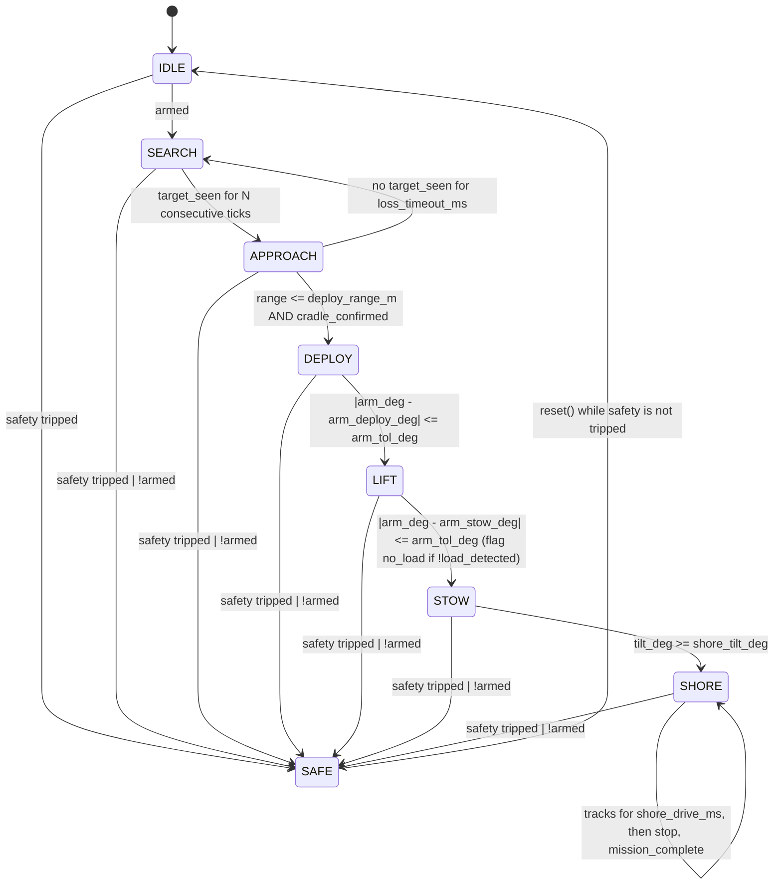

# firmware/armini · mission firmware (T1 state machine + T2 safety layer, dry run)

PlatformIO project for the Olimex ESP32-S3-DevKit-Lipo. The mission logic is
pure C++11 in `lib/core/` (no Arduino, no heap, no clock access) and is
unit-tested on the host. `src/` is the only place that includes Arduino.

**Status:** dry run. `main.cpp` runs the safety layer and the state machine at
10 Hz, fakes inputs from serial commands and prints outputs as CSV. **No pin is
driven.** Nothing here has been tested on the robot; the host tests check the
logic only.

```
pio test -e native        # host unit tests (Unity), 33 cases
pio run  -e devkit_lipo   # build for the DevKit-Lipo
pio run  -e devkit_lipo -t upload && pio device monitor   # dry run over USB-C
```

## Layout

| Path | What |
|---|---|
| `lib/core/Types.h` | `State`, `SafeReason`, `Inputs`, `Outputs`, `Config` |
| `lib/core/StateMachine.h/.cpp` | `tick(inputs, dt_ms) -> Outputs`, `reset()` |
| `lib/core/Ladder.h` | `decodeLadder(v) -> OK | LEAK | KILL`, resistor math for the A1 ladder |
| `lib/core/Safety.h/.cpp` | `Safety::tick(SafetyInputs, now_ms) -> Verdict`, `reset()`, `applyVerdict()` |
| `lib/hal/Hal.h` | abstract interface: `readInputs()`, `readSafety()`, `writeOutputs()`, `nowMs()`, `takeResetRequest()` |
| `src/hal_devkit.h/.cpp` | dry-run HAL: serial commands → `Inputs` / `SafetyInputs`, `Outputs` → CSV |
| `src/main.cpp` | 10 Hz loop: Safety → verdict → StateMachine; ESP32 task watchdog |
| `test/test_core/` | Unity tests (`test_main.cpp` + one file per module), run with `pio test -e native` |

Board id: PlatformIO has no entry for the S3 DevKit-Lipo (only the classic
`esp32-devkitlipo`), so `platformio.ini` uses `esp32-s3-devkitc-1` with
`board_build.arduino.memory_type = qio_opi` for the ESP32-S3-WROOM-1-N8R8
module. `// VERIFY` the module marking on the actual board.

## State diagram



"safety tripped" = one of `leak | kill | battery_low | heartbeat_lost` in
`Inputs`. On the robot these come from the Safety layer's verdict (below), not
from the raw sensors.

What each state outputs:

| State | thrust | tracks | arm target | pan | buzzer |
|---|---|---|---|---|---|
| IDLE | 0 | 0 | = measured arm angle (hold)¹ | 0 | off |
| SEARCH | 0 | 0 | `arm_stow_deg` | sweep `pan_min_deg`↔`pan_max_deg` at `pan_rate_deg_s` | off |
| APPROACH | fwd `approach_thrust`, diff `k_bearing·bearing_deg` | 0 | `arm_stow_deg` | hold | off |
| DEPLOY | 0 | 0 | `arm_deploy_deg` | hold | off |
| LIFT | 0 | 0 | `arm_stow_deg` | hold | off |
| STOW | fwd `stow_thrust`, diff `k_heading·wrap(shore_heading_deg − heading_deg)` | 0 | `arm_stow_deg` | hold | off |
| SHORE | 0 | `track_speed` for `shore_drive_ms`, then 0 | `arm_stow_deg` | hold | off |
| SAFE | 0 | 0 | angle latched on entry (hold) | 0 | **on** |

Differential: `thrust_l = fwd + diff`, `thrust_r = fwd − diff`; positive bearing
(target to starboard) turns right. `// VERIFY` the sign once the camera driver exists.

¹ Deviation from the T1 text ("IDLE: outputs zero"): commanding the arm to 0°
at power-on would swing a stowed arm (45°) into the hull, so IDLE mirrors the
measured angle instead. Thrust, tracks and pan are 0 as specified.

Rules that apply everywhere:
- Safety is evaluated first in every tick. Priority if several trip at once:
  `KILL > LEAK > BATTERY > HEARTBEAT > DISARM`. The jump to SAFE takes effect
  in the same tick (that tick's outputs are already the SAFE outputs). All
  other transitions take effect from the next tick.
- `!armed` is a SAFE cause only in mission states (SEARCH…SHORE). In IDLE
  "not armed" is the normal condition.
- SAFE latches. `reset()` returns to IDLE only if the last tick saw no leak,
  kill, battery_low or heartbeat_lost; otherwise it returns `false` and nothing
  changes. Disarm does not block reset (IDLE is itself the not-armed state).
- `tick()` has no side effects besides its own state; two instances fed the
  same input sequence produce identical outputs (tested).
- Every output is clamped: thrust/track ∈ [−1, 1], angles ∈ [`angle_min_deg`, `angle_max_deg`].

## Safety (`lib/core/Safety.h`, `lib/core/Ladder.h`)

Three lines of defence, in order:

1. **Hardware.** The logic KILL rocker pulls PCA9685 **OE** high through R10
   (2.2 kΩ to 3V3): all 16 PWM outputs (ESCs, BTS7960s, buzzer, LEDs) go off
   with no code involved, also if the wire to the rocker breaks. The 50 A
   toggle on the battery and the 30 A inline fuse sit before everything
   (`pcb/carrier-revA/SPEC.md`, `docs/FAILS_AND_FIXES.md` #42, #46).
2. **This module.** Makes the firmware agree with the hardware (it sees the
   same rocker through the ladder), adds the causes the hardware cannot see
   (leak, battery, heartbeat), debounces them, and **latches** so nothing
   restarts on its own. Its verdict is the only safety input the state machine
   ever sees.
3. **ESP32 task watchdog** (`main.cpp`): 2 s, panic + reboot if `loop()` stalls.

### Inputs

`SafetyInputs`: `leak_raw`, `kill_raw` (booleans, DevKit-Lipo breadboard 2b with
leak and kill on separate GPIOs), `v_bat` (pack volts), `heartbeat_ok`,
`ladder_v` (XIAO carrier: A1 ladder voltage, `< 0` = not fitted). If a ladder
reading is present it is decoded and **OR-ed** into leak/kill, so both board
designs use the same code and a board with both still trips on either.

A1 ladder (`Ladder.h`; R7 = 10 kΩ pull-up to 3.3 V, R8 = 4.7 kΩ leak, R9 = 1 kΩ kill):

```
v_A1 = 3.3 V · R_down / (R7 + R_down)      R_down = parallel of the closed branches
```

| Closed branches | R_down | v_A1 | decode |
|---|---|---|---|
| none | ∞ | 3.30 V | OK (> 2.0 V) |
| leak | 4.7 kΩ | 1.055 V | LEAK (0.6–2.0 V) |
| kill | 1 kΩ | 0.300 V | KILL (< 0.6 V) |
| leak + kill | 4.7 ∥ 1 = 0.825 kΩ | 0.251 V | KILL |

Both thresholds are inclusive on the LEAK side (0.6 V and 2.0 V decode as
LEAK). `ladderVoltage(leak, kill)` returns the expected value from the
formula; the tests check it reproduces the SPEC.md numbers.

VBAT: divider 100 kΩ / 33 kΩ (`hardware/wiring/PINOUT.md`), so
`v_bat = v_adc × 133 / 33` (`vbatFromAdc()`); the HAL does this, Safety gets volts.

### Causes

| Cause | Trips when | Debounce | Clears when |
|---|---|---|---|
| KILL | `kill_raw` or ladder < 0.6 V | **none** — first tick seen | input false |
| LEAK | `leak_raw` or ladder 0.6–2.0 V continuously for `leak_debounce_ms` | 100 ms | input false (timer restarts from 0) |
| BATTERY | `v_bat < v_trip` continuously for `batt_debounce_ms` | 500 ms | `v_bat > v_reset` (hysteresis; between the two it stays active) |
| HEARTBEAT | `heartbeat_ok == false` continuously for `heartbeat_timeout_ms` | 500 ms | input true |

Kill is the only cause without debounce. A 50 ms splash does not trip LEAK; a
single bad ADC sample does not trip BATTERY. Priority if several trip in the
same tick: `KILL > LEAK > BATTERY > HEARTBEAT`.

### Latch and reset

- `tick()` returns `Verdict { safe, reason }`. Once any cause trips,
  `safe == false` and `reason` is **frozen** until `reset()`, even if the cause
  clears and even if a higher-priority cause appears later (`active()` tells
  what is active right now).
- `reset()` succeeds only while tripped **and** no cause was active in the
  most recent tick. With an active cause it returns `false` and changes
  nothing. A pack at 10.2 V after a 9.9 V trip is still an active cause
  (hysteresis), so reset is refused until it reads above 10.5 V.
- `main.cpp` on the operator's `reset`: `safety.reset()` first, then the state
  machine ticks once with the cleared verdict, then `sm.reset()`. The CSV
  shows SAFE for that tick and IDLE from the next.

### Config (`SafetyConfig`)

| Parameter | Default | Status |
|---|---|---|
| `leak_debounce_ms` | 100 ms | VERIFY: task T2 default |
| `batt_debounce_ms` | 500 ms | VERIFY: task T2 default |
| `heartbeat_timeout_ms` | 500 ms | VERIFY: task T2 default |
| `v_trip` | 9.9 V (3.3 V/cell, 3S) | VERIFY: Teddy decides |
| `v_reset` | 10.5 V (3.5 V/cell) | VERIFY: Teddy decides; must be > `v_trip` |
| ladder thresholds (`Ladder.h`) | 0.6 V / 2.0 V | SOURCE: task T2; VERIFY on the breadboard with the ESP32 ADC |
| resistor values (`Ladder.h`) | 10 k / 4.7 k / 1 k | SOURCE: `pcb/carrier-revA/SPEC.md` R7/R8/R9 |
| VBAT gain (`Safety.h`) | 133/33 | SOURCE: `hardware/wiring/PINOUT.md` |

`heartbeat_ok` in the dry run is a fake input (`hb 0|1`). On the robot it is
meant for the operator / Pi link; `// VERIFY` which link once it exists. The
main loop itself is guarded by the task watchdog, not by this input.

## Config parameters (`lib/core/Types.h`)

Nothing below has been measured. `SOURCE` = taken from a project file;
`VERIFY` = placeholder, Teddy measures or decides.

| Parameter | Default | Unit | Status |
|---|---|---|---|
| `pan_min_deg` | 45 | ° | VERIFY: mechanical range of the pan servo |
| `pan_max_deg` | 135 | ° | VERIFY |
| `pan_rate_deg_s` | 30 | °/s | VERIFY: vs. MLX90642 frame rate |
| `sightings_to_confirm` | 3 | ticks | VERIFY |
| `loss_timeout_ms` | 2000 | ms | VERIFY |
| `approach_thrust` | 0.30 | − (0..1) | VERIFY |
| `k_bearing` | 0.02 | 1/° | VERIFY |
| `deploy_range_m` | 0.50 | m | VERIFY |
| `arm_deploy_deg` | 215 | ° | SOURCE: `cad/openscad/AR-Mini_v1.scad` `deploy_a` |
| `arm_stow_deg` | 45 | ° | SOURCE: `cad/openscad/AR-Mini_v1.scad` `stow_a` |
| `arm_tol_deg` | 5 | ° | VERIFY: ST3215 feedback under load |
| `shore_heading_deg` | 0 | ° | VERIFY: heading of the ramp at the test site |
| `k_heading` | 0.01 | 1/° | VERIFY |
| `stow_thrust` | 0.30 | − (0..1) | VERIFY |
| `shore_tilt_deg` | 10 | ° | VERIFY: pitch that means "bow on the ramp" |
| `track_speed` | 0.50 | − (0..1) | VERIFY |
| `shore_drive_ms` | 3000 | ms | VERIFY |
| `angle_min_deg` / `angle_max_deg` | 0 / 270 | ° | SOURCE: task T1; VERIFY against the servo range |

Battery thresholds moved to `SafetyConfig` (`v_trip` / `v_reset`, see Safety).

## Dry run

### CSV (one row per tick, 10 Hz)

```
t_ms,state,reason,thrust_l,thrust_r,track_l,track_r,arm_deg,pan_deg,buzzer,flags
```

| Column | Meaning |
|---|---|
| `t_ms` | ms since boot |
| `state` | `IDLE SEARCH APPROACH DEPLOY LIFT STOW SHORE SAFE` |
| `reason` | `NONE LEAK KILL BATTERY HEARTBEAT DISARM` (why SAFE; NONE otherwise) |
| `thrust_l`, `thrust_r` | −1..1 |
| `track_l`, `track_r` | −1..1 |
| `arm_deg`, `pan_deg` | target angles |
| `buzzer` | 0/1 |
| `flags` | bitmask: bit0 `no_load`, bit1 `mission_complete`, bit2 LED green (status), bit3 LED yellow (armed), bit4 LED red (fault) |

Lines starting with `#` are comments (banner, command acknowledgements, help).

### Serial commands (115200 baud, newline-terminated)

Fake inputs persist until changed.

| Command | Sets |
|---|---|
| `arm 0\|1` | `armed` |
| `see 0\|1 [bearing_deg] [range_m]` | `target_seen`, `bearing_deg`, `target_range_m` (e.g. `see 1 12.5 1.8`) |
| `cradle 0\|1` | `cradle_confirmed` |
| `armdeg <deg>` | `arm_deg` (servo feedback) |
| `load 0\|1` | `load_detected` |
| `tilt <deg>` | `tilt_deg` |
| `heading <deg>` | `heading_deg` |
| `leak 0\|1` | `SafetyInputs::leak_raw` (debounced by Safety) |
| `kill 0\|1` | `SafetyInputs::kill_raw` (immediate) |
| `vbat <V>` | `SafetyInputs::v_bat` (trip < `v_trip` for `batt_debounce_ms`, clear > `v_reset`) |
| `hb 0\|1` | `SafetyInputs::heartbeat_ok` |
| `ladder <V>` | `SafetyInputs::ladder_v`; `-1` = not fitted. Try `1.06` (LEAK) and `0.30` (KILL) |
| `reset` | `Safety::reset()` then `StateMachine::reset()` in the next tick; both results are printed as `#` lines |
| `?` | help + current fake inputs |

Initial fake values: not armed, no target (range 100 m), arm at `arm_stow_deg`,
vbat 12.6 V (simulated full 3S), heartbeat ok, no ladder, no faults.

### Happy-path script (type one line at a time, watch the `state` column)

```
arm 1                  -> SEARCH (pan sweeps)
see 1 10 5             -> APPROACH after 3 ticks (thrust_l > thrust_r)
see 1 0 0.4
cradle 1               -> DEPLOY (arm_deg target 215)
armdeg 215             -> LIFT (arm_deg target 45)
load 1
armdeg 45              -> STOW (thrust forward)
tilt 12                -> SHORE (tracks 0.5 for 3 s, then 0, flags bit1 set)
leak 1                 -> SAFE one tick later (100 ms debounce), reason LEAK, buzzer 1
reset                  -> "# safety reset: refused" while leak 1
leak 0
reset                  -> "# safety reset: ok", "# reset: ok"; IDLE next tick; then SEARCH again because arm is still 1
```

Safety-only script (from any state):

```
kill 1                 -> SAFE in the same tick, reason KILL
kill 0 / reset         -> IDLE
vbat 9.8               -> SAFE after 500 ms, reason BATTERY
vbat 10.2 / reset      -> refused (hysteresis: below v_reset 10.5)
vbat 10.6 / reset      -> ok
hb 0                   -> SAFE after 500 ms, reason HEARTBEAT
hb 1 / reset           -> ok
ladder 1.06            -> SAFE after 100 ms, reason LEAK (ladder path)
ladder -1 / reset      -> ok
```

## Tests (`pio test -e native`)

All files in `test/test_core/` link into one Unity executable; `test_main.cpp`
holds `setUp`/`main` and calls one runner per module.

`test_state_machine.cpp` (T1, 15 cases): IDLE→SEARCH on arm; exactly N
consecutive sightings (N−1 + miss resets); loss timeout and counter reset;
DEPLOY needs range **and** cradle (3 cases); full happy path incl. SHORE stop
after `shore_drive_ms`; SAFE from each of the 7 states on leak; SAFE reasons
for kill / battery / heartbeat / disarm and the priority; SAFE outputs zero
with buzzer on and arm held; reset latch; clamping with absurd gains;
determinism over 2000 pseudo-random ticks. Extra: pan sweep stays within
limits; `no_load` flag.

`test_ladder.cpp` (T2, 4 cases): the four voltage levels; the formula
reproduces SPEC.md; both thresholds exactly at the boundary; negative = not
present.

`test_safety.cpp` (T2, 14 cases): leak 50 ms no trip / 100 ms trip and timer
restart; kill on the first tick; same-tick priority (4 combinations); battery
one sample / 600 ms / 10.2 V reset refused / 10.6 V accepted, and the
pre-trip debounce; heartbeat 400 / 500 ms; latch with frozen reason; verdict
→ StateMachine integration (SEARCH + leak 100 ms → SAFE, reset order as in
`main.cpp`, HEARTBEAT reason); ladder path ≡ boolean path over 3000 random
ticks; ladder OR-ed with booleans; determinism; VBAT divider; `millis()` wrap.

Build flags for the host: `-std=c++11 -Wall -Wextra -Werror`.
