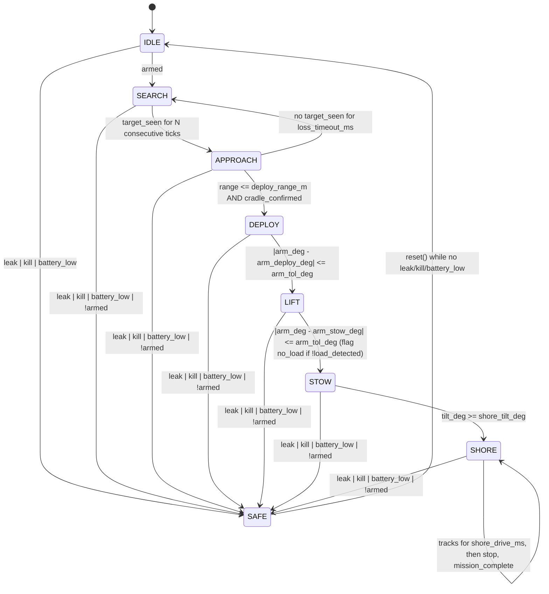

# firmware/armini · mission firmware (T1: state machine, dry run)

PlatformIO project for the Olimex ESP32-S3-DevKit-Lipo. The mission logic is
pure C++11 in `lib/core/` (no Arduino, no heap, no clock access) and is
unit-tested on the host. `src/` is the only place that includes Arduino.

**Status:** dry run. `main.cpp` runs the state machine at 10 Hz, fakes inputs
from serial commands and prints outputs as CSV. **No pin is driven.** Nothing
here has been tested on the robot; the host tests check the logic only.

```
pio test -e native        # host unit tests (Unity), 15 cases
pio run  -e devkit_lipo   # build for the DevKit-Lipo
pio run  -e devkit_lipo -t upload && pio device monitor   # dry run over USB-C
```

## Layout

| Path | What |
|---|---|
| `lib/core/Types.h` | `State`, `SafeReason`, `Inputs`, `Outputs`, `Config` |
| `lib/core/StateMachine.h/.cpp` | `tick(inputs, dt_ms) -> Outputs`, `reset()` |
| `lib/hal/Hal.h` | abstract interface: `readInputs()`, `writeOutputs()`, `nowMs()`, `takeResetRequest()` |
| `src/hal_devkit.h/.cpp` | dry-run HAL: serial commands → `Inputs`, `Outputs` → CSV |
| `src/main.cpp` | 10 Hz loop |
| `test/test_core/test_state_machine.cpp` | Unity tests, run with `pio test -e native` |

Board id: PlatformIO has no entry for the S3 DevKit-Lipo (only the classic
`esp32-devkitlipo`), so `platformio.ini` uses `esp32-s3-devkitc-1` with
`board_build.arduino.memory_type = qio_opi` for the ESP32-S3-WROOM-1-N8R8
module. `// VERIFY` the module marking on the actual board.

## State diagram



What each state outputs:

| State | thrust | tracks | arm target | pan | buzzer |
|---|---|---|---|---|---|
| IDLE | 0 | 0 | = measured arm angle (hold)¹ | 0 | off |
| SEARCH | 0 | 0 | `arm_stow_deg` | sweep `pan_min_deg`↔`pan_max_deg` at `pan_rate_deg_s` | off |
| APPROACH | fwd `approach_thrust`, diff `k_bearing·bearing_deg` | 0 | `arm_stow_deg` | hold | off |
| DEPLOY | 0 | 0 | `arm_deploy_deg` | hold | off |
| LIFT | 0 | 0 | `arm_stow_deg` | hold | off |
| STOW | fwd `stow_thrust`, diff `k_heading·wrap(shore_heading_deg − heading_deg)` | 0 | `arm_stow_deg` | hold | off |
| SHORE | 0 | `track_speed` for `shore_drive_ms`, then 0 | `arm_stow_deg` | hold | off |
| SAFE | 0 | 0 | angle latched on entry (hold) | 0 | **on** |

Differential: `thrust_l = fwd + diff`, `thrust_r = fwd − diff`; positive bearing
(target to starboard) turns right. `// VERIFY` the sign once the camera driver exists.

¹ Deviation from the T1 text ("IDLE: outputs zero"): commanding the arm to 0°
at power-on would swing a stowed arm (45°) into the hull, so IDLE mirrors the
measured angle instead. Thrust, tracks and pan are 0 as specified.

Rules that apply everywhere:
- Safety is evaluated first in every tick. Priority if several trip at once:
  `KILL > LEAK > BATTERY > DISARM`. The jump to SAFE takes effect in the same
  tick (that tick's outputs are already the SAFE outputs). All other
  transitions take effect from the next tick.
- `!armed` is a SAFE cause only in mission states (SEARCH…SHORE). In IDLE
  "not armed" is the normal condition.
- SAFE latches. `reset()` returns to IDLE only if the last tick saw no leak,
  kill or battery_low; otherwise it returns `false` and nothing changes.
  Disarm does not block reset (IDLE is itself the not-armed state).
- `tick()` has no side effects besides its own state; two instances fed the
  same input sequence produce identical outputs (tested).
- Every output is clamped: thrust/track ∈ [−1, 1], angles ∈ [`angle_min_deg`, `angle_max_deg`].
- The hardware kill (PCA9685 OE, `pcb/carrier-revA/SPEC.md`) is the first line
  of defence; this state machine is the second. A proper debounced safety layer
  is task T2.

## Config parameters (`lib/core/Types.h`)

Nothing below has been measured. `SOURCE` = taken from a project file;
`VERIFY` = placeholder, Teddy measures or decides.

| Parameter | Default | Unit | Status |
|---|---|---|---|
| `pan_min_deg` | 45 | ° | VERIFY: mechanical range of the pan servo |
| `pan_max_deg` | 135 | ° | VERIFY |
| `pan_rate_deg_s` | 30 | °/s | VERIFY: vs. MLX90642 frame rate |
| `sightings_to_confirm` | 3 | ticks | VERIFY |
| `loss_timeout_ms` | 2000 | ms | VERIFY |
| `approach_thrust` | 0.30 | − (0..1) | VERIFY |
| `k_bearing` | 0.02 | 1/° | VERIFY |
| `deploy_range_m` | 0.50 | m | VERIFY |
| `arm_deploy_deg` | 215 | ° | SOURCE: `cad/openscad/AR-Mini_v1.scad` `deploy_a` |
| `arm_stow_deg` | 45 | ° | SOURCE: `cad/openscad/AR-Mini_v1.scad` `stow_a` |
| `arm_tol_deg` | 5 | ° | VERIFY: ST3215 feedback under load |
| `shore_heading_deg` | 0 | ° | VERIFY: heading of the ramp at the test site |
| `k_heading` | 0.01 | 1/° | VERIFY |
| `stow_thrust` | 0.30 | − (0..1) | VERIFY |
| `shore_tilt_deg` | 10 | ° | VERIFY: pitch that means "bow on the ramp" |
| `track_speed` | 0.50 | − (0..1) | VERIFY |
| `shore_drive_ms` | 3000 | ms | VERIFY |
| `v_bat_low_v` | 9.9 | V | VERIFY: T2 proposes 9.9 V (3.3 V/cell); used only by the HAL to derive `battery_low` |
| `angle_min_deg` / `angle_max_deg` | 0 / 270 | ° | SOURCE: task T1; VERIFY against the servo range |

## Dry run

### CSV (one row per tick, 10 Hz)

```
t_ms,state,reason,thrust_l,thrust_r,track_l,track_r,arm_deg,pan_deg,buzzer,flags
```

| Column | Meaning |
|---|---|
| `t_ms` | ms since boot |
| `state` | `IDLE SEARCH APPROACH DEPLOY LIFT STOW SHORE SAFE` |
| `reason` | `NONE LEAK KILL BATTERY DISARM` (why SAFE; NONE otherwise) |
| `thrust_l`, `thrust_r` | −1..1 |
| `track_l`, `track_r` | −1..1 |
| `arm_deg`, `pan_deg` | target angles |
| `buzzer` | 0/1 |
| `flags` | bitmask: bit0 `no_load`, bit1 `mission_complete`, bit2 LED green (status), bit3 LED yellow (armed), bit4 LED red (fault) |

Lines starting with `#` are comments (banner, command acknowledgements, help).

### Serial commands (115200 baud, newline-terminated)

Fake inputs persist until changed.

| Command | Sets |
|---|---|
| `arm 0\|1` | `armed` |
| `see 0\|1 [bearing_deg] [range_m]` | `target_seen`, `bearing_deg`, `target_range_m` (e.g. `see 1 12.5 1.8`) |
| `cradle 0\|1` | `cradle_confirmed` |
| `armdeg <deg>` | `arm_deg` (servo feedback) |
| `load 0\|1` | `load_detected` |
| `tilt <deg>` | `tilt_deg` |
| `heading <deg>` | `heading_deg` |
| `leak 0\|1` | `leak` |
| `kill 0\|1` | `kill` |
| `vbat <V>` | `battery_low = V < v_bat_low_v` |
| `reset` | calls `StateMachine::reset()` before the next tick; the result is printed as a `#` line |
| `?` | help + current fake inputs |

Initial fake values: not armed, no target (range 100 m), arm at `arm_stow_deg`,
vbat 12.6 V (simulated full 3S), no faults.

### Happy-path script (type one line at a time, watch the `state` column)

```
arm 1                  -> SEARCH (pan sweeps)
see 1 10 5             -> APPROACH after 3 ticks (thrust_l > thrust_r)
see 1 0 0.4
cradle 1               -> DEPLOY (arm_deg target 215)
armdeg 215             -> LIFT (arm_deg target 45)
load 1
armdeg 45              -> STOW (thrust forward)
tilt 12                -> SHORE (tracks 0.5 for 3 s, then 0, flags bit1 set)
leak 1                 -> SAFE, reason LEAK, buzzer 1
reset                  -> "# reset: refused" while leak 1
leak 0
reset                  -> IDLE; then SEARCH again because arm is still 1
```

## Tests (`pio test -e native`)

Covers the T1 list: IDLE→SEARCH on arm; exactly N consecutive sightings (N−1 +
miss resets); loss timeout and counter reset; DEPLOY needs range **and** cradle
(3 cases); full happy path incl. SHORE stop after `shore_drive_ms`; SAFE from
each of the 7 states on leak; SAFE reasons for kill / battery / disarm and the
priority; SAFE outputs zero with buzzer on and arm held; reset latch; clamping
with absurd gains; determinism over 2000 pseudo-random ticks. Extra: pan sweep
stays within limits; `no_load` flag.

Build flags for the host: `-std=c++11 -Wall -Wextra -Werror`.
